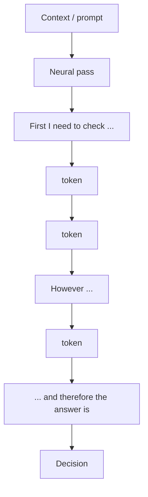
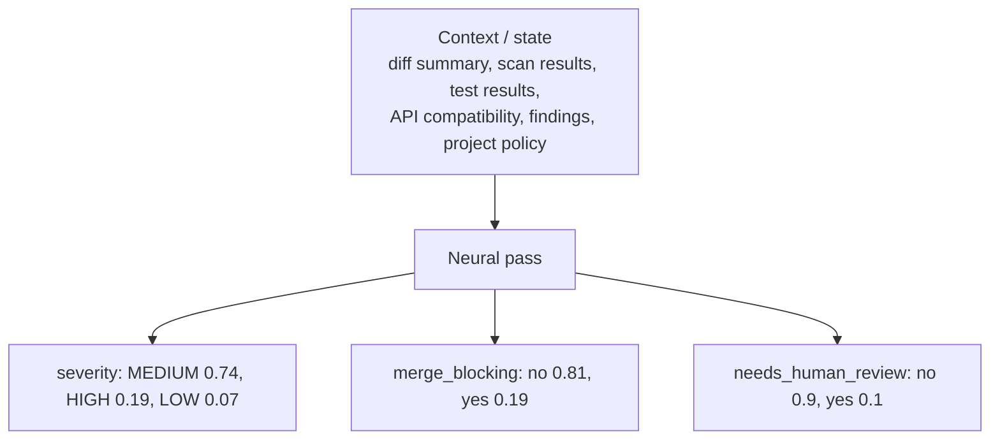
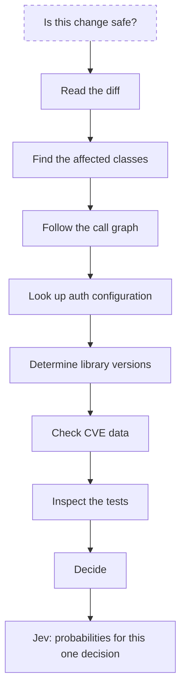
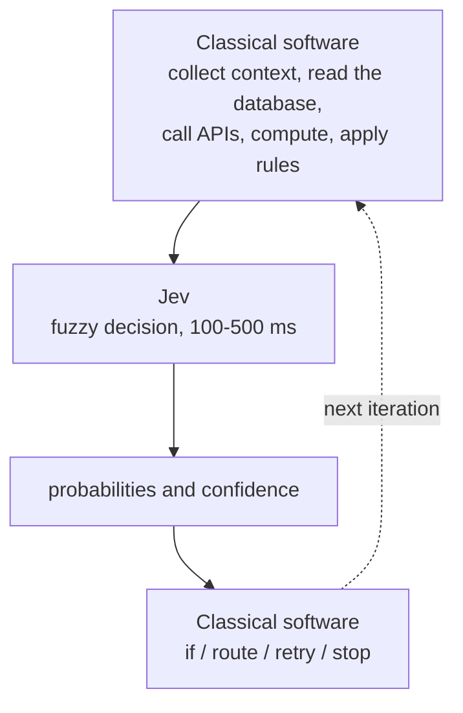
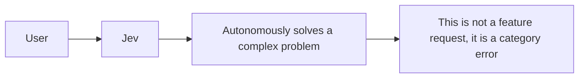
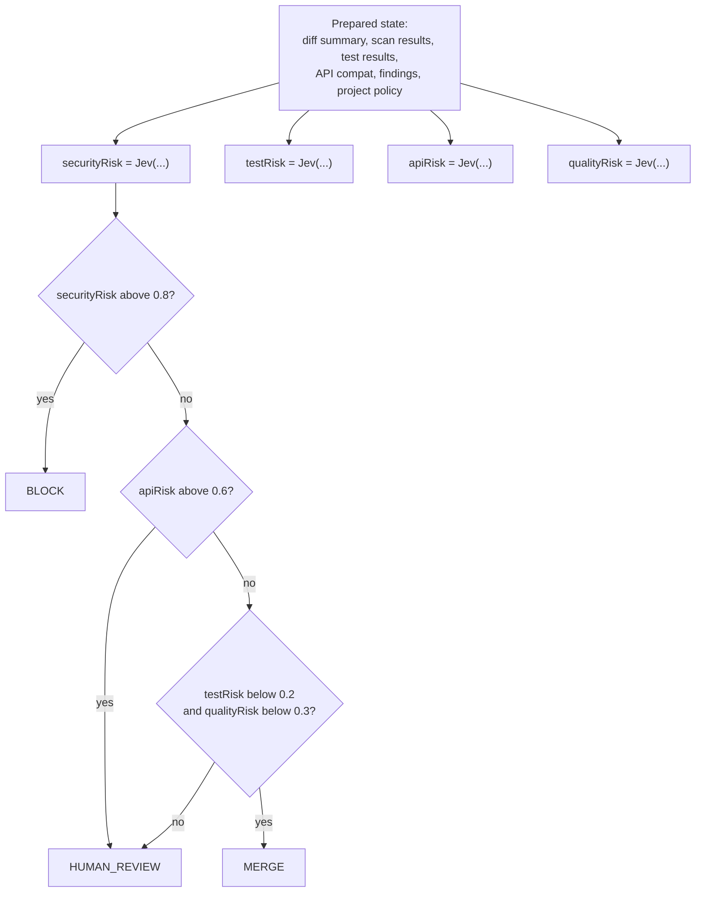
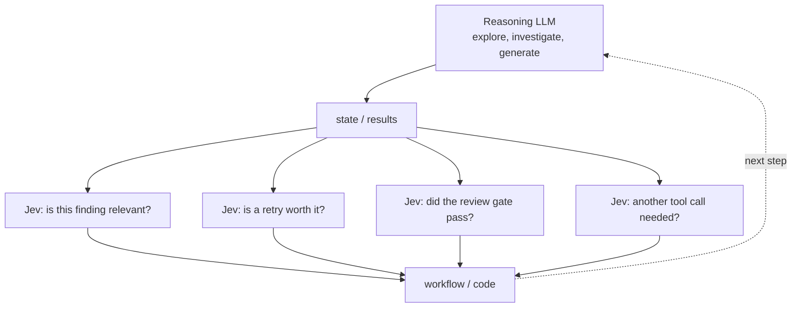
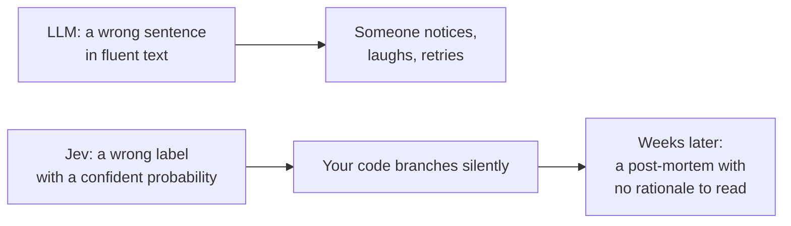

The hype train is packed again. Ever since TypeSafe AI released Jev, the internet has been full of examples that make it look like the fast, cheap alternative to a classical LLM: 70–500 ms instead of seconds, $0.042 per million input tokens, output "too cheap to meter", 40x to 200x speedups. The conclusion is drawn implicitly and sometimes explicitly: *why pay for a reasoning model, when this thing answers instantly for nothing?*

That conclusion is wrong, and it is wrong in a way that costs money. Jev is not a cheaper way to do what an LLM does. It is a different computation for a different problem — and it quietly moves the expensive part of the work into your codebase, where the hype slides, the demos and the LinkedIn posts never look.

Here is the honest version.

## The speed is not an optimization, it is a different problem

Give a reasoning model this task:

> Should this pull request be merged? Analyze the changes, consider security, tests,
> architecture and possible regressions.

Roughly this happens: context, understand, form hypotheses, intermediate steps, compare, decide, and finally *formulate an answer*. That last step is where the bill is. An LLM generates autoregressively, token by token, conditioned on the token before it. Structured JSON output does not change that — it is still one token at a time, just with a schema.

Jev gets a different shape of input:

```
STATE:
- change touches OAuth callback handling
- security scan: no findings
- tests: 142/142 passing
- API compatibility: unchanged
- review finding: possible missing null check
- project policy: severity >= HIGH blocks merge

QUESTIONS:
1. finding_severity = [NONE, LOW, MEDIUM, HIGH, CRITICAL]
2. merge_blocking = [yes, no]
3. needs_human_review = [yes, no]
```

and returns a distribution:

```
severity:
  MEDIUM: 0.74
  HIGH:   0.19
  LOW:    0.07

merge_blocking:
  no:  0.81
  yes: 0.19
```

No text. No chain of thought. All outputs in a single forward pass. TypeSafe calls the architecture a **parallel sampler** and the training method **Reinforcement Learning for Calibrated Decisions (RLCD)** — probabilities optimized against outcomes instead of against human raters' preference.

Line those two up and the "faster LLM" story collapses. The reasoning model pays for every token of its own deliberation:



Jev pays once per question and hands back a distribution:



Comparing those as if one were the optimized version of the other is like calling a calculator a faster author. Text in either way, and a transformer under the hood according to TypeSafe — but a fundamentally different compute problem.

## Does Jev not reason at all? Wrong question

Jev still has to see relationships in the state and weigh them. What it does *not* do is narrate that weighing as tokens. The difference is not "reasoning versus no reasoning", it is **where the decomposition happens**:

- With a reasoning LLM, the decomposition happens at inference time, in tokens, inside the model. You pay for it on every call, and you get a rationale you cannot trust.
- With Jev, the decomposition has to have already happened — in your questions, in your options, in the workflow that assembled the state. If you did not do that work, no parallel sampler will do it for you at 3 a.m.

So the honest sentence is not "Jev needs less reasoning". It is: *Jev relocates the reasoning, and the new location is your repository.*

## Nobody advertises the pipeline that feeds Jev

Consider the question people actually want answered:

> Is this change safe?

To answer that, someone has to walk this chain:



Jev does not collapse that chain. Not in 100 ms, not in 100 s. What it collapses is the last hop: instead of asking a model to *find out what is going on* and decide in one breath, you hand it a state that is already bite-sized and ask it to *decide*. The difference is the whole product:

> Not "figure out what the situation is." But: "here is the entire situation — decide."

That is a legitimate, valuable, genuinely hard-to-do-well thing. It is also a thing that presupposes the chain above it exists, runs, and is correct. Every millisecond Jev saves on decision latency is a millisecond some other system spent on context assembly. That system is written by you, tested by you, and paged at 3 a.m. by you.

## What a Jev integration actually looks like



And what it does not look like:



The confusion is understandable: the name "System One" — borrowed from Kahneman's fast, intuitive thinking — plus the framing of "frontier intelligence in a function call" suggests that Jev thinks like a reasoning model, only faster. It does not. It is an extremely capable, context-dependent **classifier with calibrated confidence**. An agent it is not. Calling it one is how you end up with autonomy that works in the demo and flakes in production, with nothing to read in the logs but floats.

## The reasoning moves into your program graph — and that is the good news

Here is the pattern people are actually building, for the merge decision above:



The knowledge that used to be implicit in a model's chain of thought — *security outranks style, so check security first; if security is critical, the other results do not matter anymore* — is now explicit in code. Which is genuinely better: code is diffable, reviewable, unit-testable, and it does not cost a token to branch.

But notice what had to happen for this to work. Somebody had to write down that security outranks style. Somebody had to define the four questions, the option sets, the thresholds 0.8 / 0.6 / 0.2 / 0.3, and somebody has to own the answer to "why 0.8?". With an LLM agent you never wrote any of that down and it mostly worked anyway. With Jev, the design is the product. That is not a flaw — it is the bill arriving for the architecture you skipped.

## The only combination worth building into an agent

The interesting hybrid is not "Jev instead of the reasoning model". It is a division of labour:



The expensive model does only what needs exploration or generation. The dozens of small judgements per step — relevant? retry? good enough? escalate? — go to a model that answers in milliseconds with a number attached. At 40x to 200x the speed and a small fraction of the cost per call, you can afford gates that were previously too expensive to even consider, and that is the real win: not replacing your model, but *adding judgement where you previously made do with a hard-coded rule or nothing at all*.

Now the part nobody puts on the slide: gates multiply. A chain of ten gates at 95% accuracy lands at 60% end-to-end. Twenty land at 36%. To keep twenty gates above 98% you need roughly 99.9% per gate — which is exactly why "it is just a classifier with calibrated probabilities" is not a downgrade, it is the whole requirement. And it is why your test suite now needs calibration checks on *your* distribution, not benchmark leaderboards.

## The myth of "it cannot hallucinate"

This one deserves a hard stop. TypeSafe's claim is technically careful: possible outputs are defined in advance, so the model never makes type errors, and schema matching is guaranteed. Fine. That is a statement about *form*, not about *truth*.

Jev can absolutely decide wrongly. It can label a CRITICAL finding as MEDIUM at 0.74, and your code, having been told that 0.74 is the answer, will route on it. What Jev removes is the visible failure mode, not the failure:



Hallucination has not been abolished here. It has been converted into **silent miscalibration** — and for operations, that is the worse failure mode, because a wrong sentence is loud while a wrong float is invisible, reproducible, and trusted by CI. Three consequences follow immediately:

1. **You cannot ask why.** Simon Willison's complaint is the right one: an LLM at least produces a rationale you may not trust; a decision model produces a number. If Jev flags something, which content signals tipped it off? Nobody can tell you, and bias now hides inside a float.
2. **Calibration is a claim, and it is about their distribution.** That a model returns honest probabilities does not mean it stays honest on your inputs. TypeSafe's own jaggedness notes admit weak spots on numbers, dates and adversarial content. Perturb a prompt slightly, watch a decision flip, and try to explain it to an auditor.
3. **The blast radius got bigger.** An LLM hallucinating a tool call is inconvenient. The same model buried three layers deep in a dependency chain with a latency budget is a production incident.

So: not "Jev cannot hallucinate". Rather: "Jev's wrong answers no longer look like wrong answers". If you cannot detect them, you have not automated a decision — you have automated trust.

## If you are going to build this, build it honestly

1. Keep state assembly in ordinary software. Jev decides, it does not look things up.
2. Express every decision as a question with a typed, closed option set — if you cannot, you have not thought the decision through yet.
3. Set thresholds explicitly and write down why they are what they are. A number nobody can justify is a liability, not a configuration.
4. Measure calibration on *your* inputs, not on the vendor's benchmark. Then break your inputs on purpose and watch which decisions flip.
5. Read the gate chain end to end and multiply the accuracies. Compound error is where "fast and cheap" turns into "fast, cheap and quietly wrong".
6. Never let a gate decide something you cannot explain to a reviewer, a customer or an auditor. "The model said 0.74" is not an explanation.

## Verdict: a very good tool with a very bad pitch

Jev is a serious, interesting approach, and for the right problem shape it is the best tool currently on the market: constant, documentable, cheap judgement inside ordinary software. Used well, it is what makes agentic systems affordable — cheap gates around an expensive explorer.

But it is not a replacement for LLM reasoning. It is *less* reasoning, applied precisely where reasoning was never what you needed — only a decision. Everything that made the decision hard (knowing what matters, assembling the state, choosing the questions, setting the thresholds, owning the calibration) stays on your side of the fence.

Which is the actual provocation here. The hype train is selling you speed and a price tag. What Jev really ships is a demand: write down what you actually decide, in code, with numbers, and test it. Teams that skipped that work are not going to be saved by a parallel sampler; they are going to discover, in production, that they never knew what they were asking.

Stop calling it a faster LLM. Start treating it as a receipt — for the architecture you have been postponing all along.
