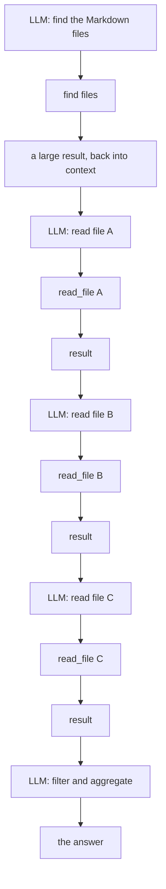
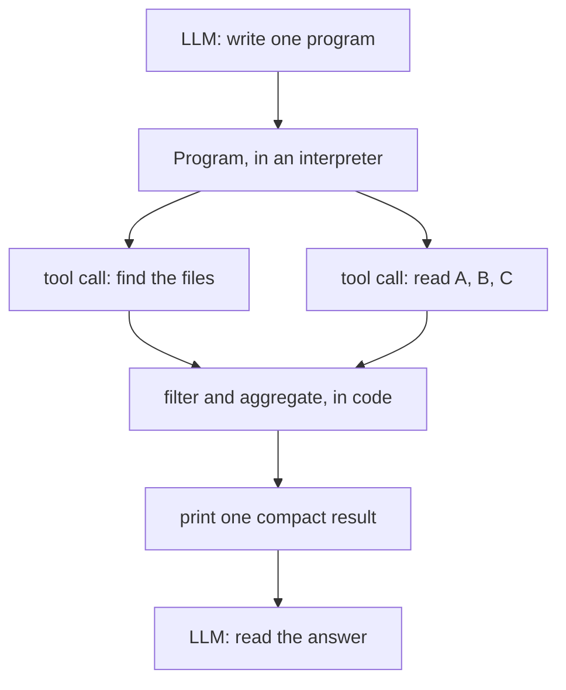
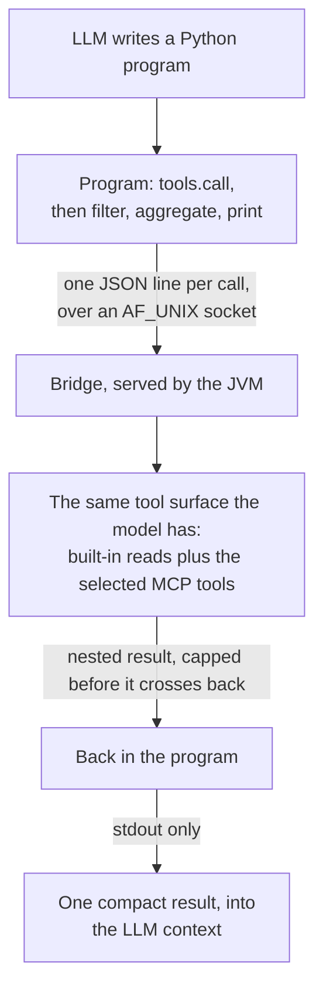
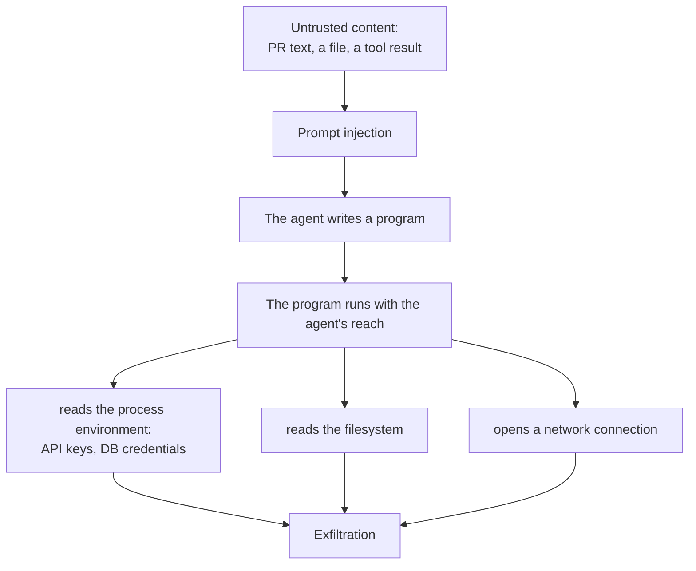

Most agent harnesses make the model the bus between every tool call: one inference to find the files, another to read each one, another to filter, another to aggregate. None of those hops requires reasoning — they are a deterministic sequence you could write in ten lines of Python — yet you pay for every one of them in tokens, in context window, and in wall-clock time. The fix is small and almost everyone has converged on it: give the model a tool that runs a script, and move the loop out of the model and into the script.

This is not a new idea, and it is not my discovery. It is worth writing down anyway, because the *why* is what decides how you build it — and the problems it creates are the ones that decide whether it survives contact with production.

## The loop everybody writes first

Ask an agent to read every Markdown file and extract the headings, and the default shape of the loop looks like this:



Look at what is actually happening. The only genuinely non-deterministic step is deciding *that* the task should be "read the files, pull the headings". Everything after that — which files, hold this result, go read the next, keep only the headings, count them — is bookkeeping. The model gets invoked for the bookkeeping anyway, once per hop, and each hop drags its payload back through the context window. The determinism is the tell: nothing in the middle of that chain needs a model. It is a for-loop wearing a chat interface.

## The shape the work actually has

The efficient version keeps the two jobs apart — the model decides, the interpreter executes:



One round in, one round out. The intermediate results — every file's full text, every intermediate list — never enter the model's context at all. Only what the program chooses to `print()` comes back.

## Why you cannot simply ship the program as a tool

The obvious objection is: if that program is so good, why not just register it as one more tool and skip the interpreter? Because you cannot write it ahead of time. The task arrives as natural language — "read the Markdown files and extract the headings" is one request; the next one is "find every TODO and group it by author", the one after that is "compare what these two files declare". The program is specific to the request, and the request is unknown until the model reads it. You cannot pre-build it, so you cannot ship it as a tool. The model has to *write* it — which means the tool you add is not a program. It is an interpreter.

That is the whole trick: register `execute-code`, a tool whose argument is source code, let the model generate the script that fits the task, run it in a sandbox, and hand back its stdout as the tool result.

## What the interpreter buys you

Three things fall out of it at once, and they compound.

1. **Missing tools are compensated by scripts.** A capability you never wrapped as a tool — a one-off parse, a join across two results, a computation — is expressible in the same program, because it is just code. This is the composability argument CodeAct makes: a constrained action space (a fixed set of pre-defined tools) both limits what the agent can reach and, worse, makes it *unable to compose multiple tools* into one action [3]. Code, tools and control flow live in one action space.
2. **Fewer round trips, so less cost, less context and less latency.** This is the point the harness vendors have now made in public. Anthropic's worked example — loading a Google Drive document and handing it to Salesforce through code instead of through the model — drives token usage *from 150,000 tokens to 2,000 tokens, a 98.7% saving*, precisely because by default "the full call transcript flows through [the model] twice" [1]. Cloudflare puts the same mechanism plainly: with the traditional approach "the output of each tool call must feed into the LLM's neural network, just to be copied over to the inputs of the next call, wasting time, energy, and tokens" [2]. Simon Willison, reading the Anthropic post, notes the same win from the other side — not round-tripping the first response through the model is "faster, more reliable, saves on context tokens, and avoids the model being exposed to any potentially sensitive data" [5].
3. **Fewer tool definitions, so still less context.** This is the half that is easy to miss. Every tool you register carries a schema and a description in the system prompt, whether or not it is used. An agent wired to hundreds of tools is "process[ing] hundreds of thousands of tokens before reading a request" [1]. Presenting the surface as code you can browse and call on demand — Anthropic calls it progressive disclosure, loading only the definitions a task needs [1] — lets one `execute-code` tool stand in for a catalogue, and an entire API fit "in 1,000 tokens" by describing operations as typed code rather than as separate tools [6].

It is the same conclusion reached independently by Anthropic's MCP team [1] and by Cloudflare's Code Mode [2][6]. The CodeAct line of research [3] and the smolagents library — whose whole premise is "code agents" that "write actions in code" rather than as JSON [4] — arrive at the same shape from the research side. When four groups with different incentives land on the same shape, it is worth understanding rather than copying by superstition.

## The return channel: the script has to reach the *real* tools

Here is where a naive implementation goes wrong. It is tempting to treat `execute-code` as a self-contained Python sandbox — a place the model can compute things, detached from the agent's actual tool surface. That throws away most of the value. The model already has the tool configurations and the MCP schemas in its context; the generated script should *use* them. The program needs a way to call the same tools the model can call, including MCP tools, from inside the sandbox.

In our implementation the bridge is deliberately thin. The script imports a small module and gets one object:

```python
import llmhelper

names  = llmhelper.tools.list()                       # what this run may call
schema = llmhelper.tools.describe("rg")               # its arguments, on demand
result = llmhelper.tools.call("rg", {"args": ["TODO"]})
print(result["output"])
```

Every call becomes one JSON line on a Unix-domain socket named by an environment variable, and the reply is decoded back into Python objects; an ordinary refusal or a failed tool comes back as a result with `success=False`, not as an exception. MCP tool names are unchanged — `mcp:<server>:<tool>` is exactly what the program passes to `tools.call(...)` — so a generated script drives the same MCP surface the model drives directly. On the Java side the frames look like this:

```
→ {"type":"tool_call","id":"3","name":"mcp:github:search_issues","arguments":{"query":"x"}}
← {"type":"tool_result","id":"3","result":{"success":true,"exitCode":0,"output":"…"}}
← {"type":"tool_error","id":"3","error":{"code":"TOOL_CALL_LIMIT","message":"…"}}
```

and the routing looks like this:



Two details matter more than they look. First, **stdout is the output channel and the socket is the control channel** — they are kept apart so a program cannot print something that is mistaken for a protocol frame. Second, **every nested result is capped before it crosses the bridge**, so a program cannot smuggle a 10 MiB file into the model's context with a careless `print()` on its last line. The isolation is structural: a nested tool result never becomes a conversation message, because it never touches the agent loop at all.

## What it changed in our own runs

The concrete result, on our side: reviewing large changes dropped to roughly *half the round trips* for the same outcome. The review agent spends its iterations gathering — read this file, check that declaration, compare the two — and those iterations are exactly the deterministic kind the interpreter collapses into one. Halving the round trips halves the inferences, and on a local model running on constrained hardware that is the difference between an agent you can afford to put in a business process and one you cannot. The token saving is welcome on a paid API; on a small local model, where throughput *is* the product, it is the whole argument.

## Security: the bill for running foreign code

Everything above is a saving. This is the part that is not, and it is the reason `execute-code` should never be a default.

You are now executing code that a model wrote, in response to input that may be hostile. A prompt injection — an instruction hidden in a file the agent reads, a PR description, a tool result — can steer the generated program, and "prompt injections do not need to be human-visible ... as long as the content is parsed by the model" [7]. Once the program runs, it runs with reach:



If the program runs in the same context as the harness, it can read the harness's secrets — API keys, passwords, the JVM's own start-time environment — touch the filesystem, and reach the network. Anthropic says as much about its own pattern: running agent-generated code "requires a secure execution environment with appropriate sandboxing, resource limits, and monitoring", and those "infrastructure requirements add operational overhead and security considerations that direct tool calls avoid" [1]. That sentence is the honest counterweight to the 98.7%.

Our posture, and it is a posture rather than a proof:

- a **scrubbed environment** for the subprocess, so the program does not inherit the harness's secrets;
- a **per-execution identity** from a pool of low-privilege accounts, one per run — so a program reads neither the service user's files nor a concurrent run's program, bridge socket or process;
- **resource limits** (`RLIMIT_AS`, `RLIMIT_CPU`, `RLIMIT_FSIZE`, `RLIMIT_NPROC`) applied by a bootstrap, with the harness-side timeout as the backstop;
- an **import guard** that refuses the obvious network and FFI modules — and which we label honestly as *defence in depth only*. A program that actually wants out does not import `socket`; it calls `subprocess` or reaches for `ctypes`. The guard raises the cost of an accident; it is not the boundary.

The real boundary is the deployment: run the whole agent somewhere it cannot hurt you, or accept the risk knowingly. The sandbox confines the filesystem and the network weakly; the identity separation and the scrubbed environment are what actually hold, and the network is open unless you close it at the container. Nothing there is free, and none of it is optional once the tool exists.

## If you build this, build it honestly

1. Add the interpreter as a tool the model can choose, not as the default path for every read. A single file read is still cheaper as a direct call; the win is in *multi-step* work.
2. Give the script the same tool surface the model has — built-in reads plus the bot's selected MCP tools — or you have built a calculator, not an agent.
3. Keep stdout and the control channel separate, cap every nested result, and set a tool-call budget per execution.
4. Scrub the environment, run under a dedicated identity, and apply rlimits. Treat the import guard as decoration, never as the boundary.
5. Make the tool opt-in per agent, and say so in the docs. It is not in the default configuration for a reason.
6. Watch the round-trip count as a first-class metric. It is the number the whole technique exists to move.

## Verdict: the cheapest optimisation is a loop that never enters the model

The interesting thing about scripting in agents is how little of it is about scripting. The tool is trivial to add; the discipline is deciding *what is actually a model's job*. Every step in an agent loop that is deterministic — fetch, filter, aggregate, compare, repeat — is one the model should not be billed for, and the interpreter is simply the mechanism that lets it step out of the way. That is worth fifty lines of Python.

What is not trivial is the bill that arrives with it: untrusted code, in your process's neighbourhood, with your secrets and your network in reach. Present the savings without the sandbox and you have shipped a foot-gun with a nice benchmark. Present both, and the pattern is what makes agents affordable enough to put next to real work — especially where the model is small and the hardware is not generous. The for-loop was never the model's job. Give it an interpreter and stop paying it to run one.

## Sources

1. [1] https://www.anthropic.com/engineering/code-execution-with-mcp — Anthropic — Code execution with MCP: Building more efficient agents
2. [2] https://blog.cloudflare.com/code-mode — Cloudflare — Code Mode: the better way to use MCP
3. [3] https://arxiv.org/abs/2402.01030 — CodeAct — Executable Code Actions Elicit Better LLM Agents
4. [4] https://huggingface.co/blog/smolagents — Hugging Face — Introducing smolagents, agents that write actions in code
5. [5] https://simonwillison.net/2025/Nov/4/code-execution-with-mcp — Simon Willison — Code execution with MCP (commentary)
6. [6] https://blog.cloudflare.com/code-mode-mcp — Cloudflare — Code Mode: give agents an entire API in 1,000 tokens
7. [7] https://genai.owasp.org/llmrisk/llm01-prompt-injection — OWASP — LLM01:2025 Prompt Injection
