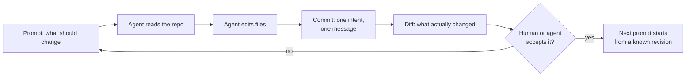
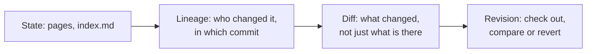

Agent memory is not a feature. It is lock-in with a nicer name. Every harness ships its own format — a `CLAUDE.md`, a per-project auto-memory directory, a store under the vendor's home folder, a vector index — and calls it memory. None of them can read the others', and the field says so out loud: "memory for agents is still early, with little to no standards."[1]

The one format every harness already speaks, and every model has been trained on, is a git repository. That is not a compromise: it is the only memory substrate that also stores *how* the memory changed — which is the question an agent needs answered to decide what to do next.

## You already work in commits

The loop has not changed since the first coding agent: you prompt, the agent reads, the agent patches, you look at the diff, you prompt again. Some tools have stopped pretending otherwise — aider commits every edit it makes with a descriptive message, so `/undo` and `git log` are the review surface,[2] and Claude Code carries a git status snapshot in its context from the first turn.[3]



Nothing in that loop needs a memory service. It needs a place where state is written down, attributed, and reversible. That is a description of git, not of a memory product.

## Four designs, zero portability

Ask where yesterday's context lives and you get four incompatible answers.

**Files a human writes.** `CLAUDE.md` in four scopes, loaded from the filesystem root down.[4] The rest of the market copies the idea with its own spelling: `AGENTS.md` from the repository root down, `.cursor/rules` with model-decided relevance, `.github/copilot-instructions.md` with an `applyTo` glob, `GEMINI.md` in three tiers. Every vendor picked a different filename, a different discovery order and a different cap, then documented the result as a standard.

**Files the model writes.** Claude Code keeps a `MEMORY.md` index plus topic files under `~/.claude/projects/<project>/memory/`, loads the first 200 lines or 25 KB, and errors when the index outgrows that, because everything past the cap is dropped on the next load.[4] Codex keeps a store under `~/.codex/memories/`, written in the background, off by default. Two answers to one problem, sharing nothing but the shape of a path.

**Compression.** When the window fills, Claude Code summarises the transcript, re-injects `CLAUDE.md` and auto memory from disk, re-reads up to five recently touched files, and summarises path-scoped rules away.[3] Compaction is a lossy summary produced by the party that benefits from you not checking it — and for most users it is the only "memory" they ever get.

**Retrieval.** Letta gives the agent a git-backed memory filesystem.[5] Mem0 sells extraction and consolidation as a service behind a tool, and benchmarks it against simply keeping the whole conversation in context.[6] Every design is defensible in isolation. Together they mean one thing: the knowledge an agent accumulates does not leave the harness that accumulated it. Switch tools and the memory is gone, because it was never a portable artifact — it was a vendor's internal format. The only thing that crosses the boundary is the repository both tools were pointed at.

## The wiki got halfway, and called it done

The most interesting counter-design is the agent-maintained wiki. Karpathy's "LLM wiki" pattern is a page of instructions that makes the agent build and maintain an interlinked knowledge base between the raw sources and the answers: three layers, three operations (ingest, query, lint), and two navigation files — `index.md` as the catalog, `log.md` as an append-only timeline.[7]

It beats naive RAG, and for the right reason: a wiki compiles knowledge once and keeps it current, while chunk retrieval re-derives the same structure on every query.[1] The agent stops rediscovering and starts accumulating. That is real progress — and it is also where the pattern stops.

A wiki remembers what is true now. It cannot tell you what it used to believe, or why it changed its mind. Its `log.md` is a diary kept by the same model that writes the pages it describes — a greppable header convention (`## [2026-04-02] ingest | Article Title`) with nothing verifying that it matches the content.[7] No line-level provenance, no "who changed this sentence, in which revision", no way to check out the wiki as it stood when the last good answer was produced. And the pattern's own sizing table concedes the ceiling: many concurrent writers and likely merge conflicts are exactly the condition that pushes you off the pure wiki.[7] That is not memory. That is a rumour with good typography.

The artifact is described, in the same breath, as "a git repo of markdown".[7] Which is the whole argument. The wiki is not the alternative to git — it is what you build on top of it, and git is the half that turns a pile of pages into a history.



## What a commit gives you that a wiki cannot

A repository is a memory format in which every write is an atomic object with an author, a timestamp, a parent and a diff. Six capabilities fall out of that for free.

**Cheap incremental views.** `git diff` answers "what changed" without loading the tree; `git log -p` walks the patches. On one of our own repositories — 1,157 tracked files, 1,100 commits — the whole subject log is 100 KB, the same log with per-file stats is 494 KB, a single commit's patch is 223 bytes, and `log`, `show` and `diff` answer in 0.00 to 0.14 s locally. You never summarise that history; you read a slice of it. An agent that can read its own last three diffs knows what it already tried, without re-deriving the attempt from a compacted transcript.

**Provenance at line level.** `git blame` attributes every line to a commit, with author and timestamp. The agent can ask *when* a rule entered its knowledge and *what else* changed in the same commit — the question a wiki's `log.md` can only answer on trust.

**Addressable revisions.** Every state has a name: a SHA, a tag, `HEAD~5`, a branch. A prompt can pin context ("compare against `v1.4.0`"), and `git show <rev>:<path>` reads the file as it was, not as it is.

**Isolation for parallel work.** Branch and worktree give each agent its own copy of memory with a merge path back — the mechanism Letta's context repositories use for concurrent memory subagents.[5]

**Review of knowledge, not just code.** A pull request over memory files means a proposal, a diff, a comment thread and an accepted revision. The wiki's lint pass is a checklist. A PR is a decision with an audit trail.

**Reversibility.** `git revert` and `git bisect` work on knowledge the way they work on code: a wrong belief can be removed without archaeology, and the commit that introduced it can be found by binary search. No memory product sells you that, because a memory product's business model depends on your knowledge living in its format.

## The best argument comes from a memory vendor

Letta benchmarked an agent that simply keeps conversation history in files and gives the model `grep` and `open`: 74.0% on LoCoMo with GPT-4o-mini, against 68.5% for the best published graph-memory variant of Mem0.[8] The explanation matters more than the number. Agents are effective with filesystem tools because those tools are in their training data, and they iterate their own queries until they find the answer — which single-shot retrieval cannot.[8]

Anthropic argues the same from the other side: pre-computed retrieval goes stale, so the better pattern keeps lightweight identifiers — paths, queries — and loads content just in time.[9] A git repository is that pattern with a history attached, and the navigation tools already exist: checkout, grep, log, show, blame. No embedding pipeline, no schema, no MCP server, nothing that can drift out of sync with the source of truth. The setup cost of "git as memory" is a clone — that is the entire integration project.

## Gitea: one compose file and a wizard

Start with the compose file and a single command:

```bash
docker compose up -d
```

The instance then answers on `:3000`, where a browser wizard finishes the install.[10] Prefer no containers? The release binaries ship with SQLite built in and the assets embedded — one file, `gitea web`, done.

What you get is a memory surface rather than a bare remote: GitHub-Flavoured Markdown rendered in the browser, with frontmatter, tables of contents and relative links resolved against the current git ref; a blame view with per-line author and commit; a per-repository wiki whose pages are versioned too; `git grep` search; webhooks on push and pull request events; Gitea Actions for scheduled jobs; teams with per-repository permissions.

That combination is the part the memory vendors cannot match: the same instance holds the agent's working repository — diffs, commits, blame — and the wiki for the knowledge you want a human to curate. Not two products, one hostname.

## Where this breaks

Git records what was committed, not what should be remembered. It will store a wrong belief with a beautiful commit message. Curation is still your job; all git adds is the ability to see what you did.

`grep` is not recall. A repository answers exact-match and path questions brilliantly and "something about the pricing bug, I think" badly. If your knowledge is thousands of unrelated facts that need fuzzy semantic retrieval, a repository alone is the wrong tool and a hybrid index is the honest answer. That is a smaller bill than a format you cannot leave.

Merge conflicts are real. Two agents learning at once will disagree and git will stop and make someone resolve it. That is more work than last-write-wins — and it is the only version where the disagreement is visible instead of silently lost.

History grows. 494 KB for 1,100 commits is fine; a repository per agent per day is not. Prune, squash, or start a new memory repository per project.

Permissions are coarse: per repository, not per file. If a shared context must be partially readable, split it.

## If you build this, build it honestly

1. One repository per agent or per project. Shared memory across unrelated projects is how a knowledge base becomes a junk drawer.
2. Make the commit message the schema. One intent per commit, the "why" in the body — the only index a later reader, human or model, is guaranteed to see next to the diff.
3. Commit before and after every agent task, so the diff of the run is a first-class artifact and `git show` is the agent's own report.
4. Point the harness at the repository, not at a copy: `AGENTS.md` or `CLAUDE.md` at the root, skills and wiki pages in the tree, `git` available in the sandbox.
5. Stable knowledge in the wiki, working knowledge in commits. The wiki is the part a human reviews; it is not the scratchpad.
6. One worktree or branch per parallel agent, merged deliberately. The conflict is the signal.
7. Automate the boring part — a webhook on push, an Action on a schedule — so memory is reconciled without anyone remembering to reconcile it.

## Verdict: the lock-in is the product

The harnesses will keep disagreeing about memory, because each is optimising something different: the instruction file optimises control, the auto-memory store convenience, the compaction pass cost, the vector index recall. None of them is a shared format, none of them records how the knowledge got there, and every one of them keeps your context inside a product you would have to leave behind.

A git repository does not win on any single axis. It wins because it is the only one that is simultaneously writable by every harness, readable by every human, diffable, attributable and reversible — and because the incremental loop we already run produces exactly the artifact git is good at: a sequence of small, reviewable changes.

Keep your prompts in files, your knowledge in commits, and your wiki in the same repository. Then "where does the agent remember things?" is a URL you can clone, and "why does it believe that?" is a commit you can read. Anything else is a vendor holding your memory hostage and calling it a feature.

## Sources

1. [1] https://www.langchain.com/blog/wiki-memory — LangChain — Wiki Memory
2. [2] https://aider.chat/docs/git.html — aider — Git integration
3. [3] https://code.claude.com/docs/en/context-window — Claude Code Docs — Explore the context window
4. [4] https://code.claude.com/docs/en/memory — Claude Code Docs — How Claude remembers your project
5. [5] https://www.letta.com/blog/context-repositories — Letta — Introducing Context Repositories: Git-based Memory for Coding Agents
6. [6] https://arxiv.org/abs/2504.19413 — Mem0 — Building Production-Ready AI Agents with Scalable Long-Term Memory
7. [7] https://www.explainx.ai/blog/karpathy-llm-wiki-pattern-agent-memory-guide-2026 — explainx.ai — Karpathy LLM Wiki: The Pattern Behind Agent Memory
8. [8] https://www.letta.com/blog/benchmarking-ai-agent-memory — Letta — Benchmarking AI Agent Memory: Is a Filesystem All You Need?
9. [9] https://www.anthropic.com/engineering/effective-context-engineering-for-ai-agents — Anthropic — Effective context engineering for AI agents
10. [10] https://docs.gitea.com/installation/install-with-docker — Gitea Docs — Installation with Docker
